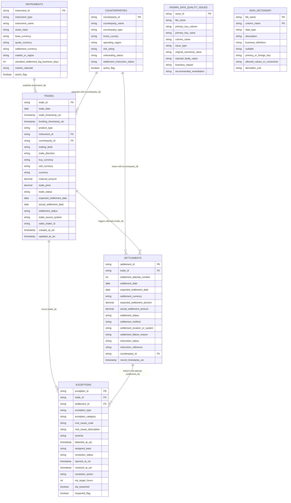

# Trade Operations Intelligence & Exception Monitoring Platform

An institutional financial middle- and back-office trade operations intelligence platform, analytical database engine, and interactive dashboard built for institutional banks and broker-dealers. 

The platform simulates and analyzes the operational lifecycle of institutional financial trades from execution, booking, and confirmation through to depository clearing, settlement matching, exception detection, multi-factor prioritization, and root-cause resolution.

---

## 1. Executive Summary & Banking Scenario

In tier-1 institutional financial institutions, trade execution is only the beginning of an extensive, risk-sensitive operational pipeline. Following front-office execution by sales traders or electronic algorithmic gateways, trades flow through middle-office trade capture and confirmation engines before being instructed into domestic and international central securities depositories (CSDs/ICSDs) such as **CLS Bank** for FX, **DTCC / Fedwire** for US cash securities, and **Euroclear / Clearstream** for international fixed income.

Throughout this post-trade lifecycle, operational friction arises:
- **Booking Discrepancies**: Manual portal ticket keying errors, account misallocations, or format translation breaks between front-office order management systems (OMS) and back-office clearing engines.
- **Reference Data Deficiencies**: Outdated, expired, or missing Standard Settlement Instructions (SSIs) in static data repositories.
- **Confirmation Breaks**: Economic affirmation mismatches (price, notional, rate tolerances) between counterparties prior to settlement.
- **Settlement Failures**: Short inventory, stock borrow and lending (SBL) delivery fails, counterparty liquidity shortages, or depository clearing cutoff deadline breaches.
- **Operational Backlogs & SLA Breaches**: Capacity bottlenecks during quarter-end volume surges or market infrastructure outages.

This platform converts raw operational data into actionable intelligence, providing settlement monitoring, root-cause attribution, counterparty risk stratification, and deterministic exception prioritization.

---

## 2. System Architecture & Relational ER Model

The relational architecture models middle- and back-office operations across seven tables:



### Table Definitions & Grain

| Table Name | Primary Key | Foreign Keys | Row Count | Business Definition & Grain |
| :--- | :--- | :--- | :--- | :--- |
| **`trades`** | `trade_id` | `instrument_id`, `counterparty_id` | **50,000** | One record per trade ticket. Captures economic execution terms, front-office desk, booking system, and trade lifecycle status. |
| **`settlements`** | `settlement_id` | `trade_id`, `counterparty_id` | **52,385** | Settlement clearing instructions and retry attempts (Attempt 1, 2, 3) submitted to depositories. |
| **`exceptions`** | `exception_id` | `trade_id`, `settlement_id` (nullable) | **5,060** | Operational exceptions, triage team assignments, root cause descriptions, and deterministic SLA tracking. |
| **`counterparties`** | `counterparty_id` | None | **150** | Institutional entity master detailing client types, risk ratings, KYC status, and SSI health. |
| **`instruments`** | `instrument_id` | None | **160** | Reference security and contract master across FX, Debt, Equities, and Interest Rate Swaps. |
| **`data_dictionary`** | `(file_name, column_name)` | None | **85** | Metadata dictionary covering all fields, types, constraints, and derivation logic. |
| **`known_data_quality_issues`**| `issue_id` | Target PK pointer | **19** | Documented catalog of intentionally seeded operational data-quality anomalies for pipeline validation. |

---

## 3. Product Conventions & Settlement Assumptions

Financial operations differ fundamentally by asset class. The platform implements authentic, product-specific market conventions:

| Product Type | Share of Trades | Standard Settlement Lag | Clearing Mechanism | Primary Depository / Venue | Price Representation |
| :--- | :--- | :--- | :--- | :--- | :--- |
| **FX_SPOT** | ~28% | T+2 (USD/CAD T+1) | Payment-versus-Payment (PVP) | CLS Bank | Currency exchange rate (e.g. 1.0850) |
| **GOVERNMENT_BOND** | ~20% | T+1 (US/UK), T+2 (EU Bunds) | Delivery-versus-Payment (DVP) | Fedwire / Euroclear | % of par (clean price, e.g. 99.25) |
| **CORPORATE_BOND** | ~16% | T+1 (US SEC post-May 2024), T+2 (EU) | Delivery-versus-Payment (DVP) | DTCC NSCC / Euroclear | % of par (e.g. 98.10) |
| **FX_FORWARD** | ~14% | Forward Value Date (T+22 to T+260) | Bilateral Gross Payment | SWIFT GPI Network | Outright forward rate |
| **EQUITY** | ~14% | T+1 (US SEC), T+2 (UK/EU) | Delivery-versus-Payment (DVP) | DTCC NSCC / CREST | Price per share (Notional = Shares × Price) |
| **INTEREST_RATE_SWAP** | ~8% | T+2 (Effective / Upfront) | Net Cash Settlement | CHIPS / Clearinghouse (LCH/CME) | Fixed swap coupon % (e.g. 4.15%) |

### Calendar & Business Day Conventions
- **No Weekend Execution**: 100% of trades occur Monday through Friday.
- **Recognized Market Holidays**: Modeled holidays (New Year's Day, MLK Day, Presidents' Day, Good Friday, Easter Monday, Memorial Day, Juneteenth, Independence Day, Labor Day, Thanksgiving, Christmas, Boxing Day) have 0 trade executions.
- **Volume Skew**: Quarter-ends (March, June, September, December) feature an 85% volume surge mimicking institutional window-dressing and balance-sheet rebalancing.
- **Intraday UTC Peak**: Concentrated during the London/New York overlap (13:00 to 17:00 UTC).
- **Year-End Pending Preservation**: Trades executed in late December 2025 with settlement lags extending into January 2026 preserve their contractual `PENDING` state with null `actual_settlement_date`, rather than fabricating premature completions.

---

## 4. Operational Failure Mechanisms & Calibration Targets

The dataset is calibrated to mirror real-world institutional operational distributions:

### Achieved Calibration Metrics
1. **Initial Trade Settlement Failure Incidence**: **4.51%** (Target: 1.0% – 5.0%)
   - Calculated as: `(Attempt 1 Fails) / (Total Completed Trades in 2025)`.
   - Driven by outdated counterparty SSIs, collateral borrow lags, cash liquidity shortages, and depository cutoff breaches.
2. **Trades with >=1 Operational Exception**: **9.71%** (Target: 5.0% – 15.0%)
   - Includes both pre-settlement breaks (booking errors, affirmation mismatches) and post-settlement delivery failures.
3. **Exception SLA Breach Rate**: **24.57%** (Target: 10.0% – 25.0%)
   - Derived deterministically: `(resolved_at - opened_at) > sla_target_hours`.
   - SLA targets: CRITICAL (4 hours), HIGH (8 hours), MEDIUM (24 hours), LOW (48 hours).
4. **Unresolved Operational Backlog**: **207 exceptions (4.09%)**
   - Active tickets in status `IN_PROGRESS`, `ESCALATED`, or `PENDING_CLIENT_RESPONSE` at the close of 2025.
5. **Settlement Retry Dynamics**:
   - **Attempt 1**: 50,000 instructions submitted.
   - **Attempt 2**: 2,100 retries scheduled on T+1 after operational triage (~80% success).
   - **Attempt 3**: 285 second retries for complex borrow/liquidity fails.

### Operational Disruption Windows
Two realistic operational disruption periods were simulated:
1. **May 27–29, 2025**: Post-Memorial Day cross-border depository clearing release causing elevated SSI mismatches.
2. **October 14–16, 2025**: Depository messaging queue latency spike causing depository cutoff deadline breaches.

---

## 5. Seeded Data Quality Issues Catalog

To support automated data-quality testing and ETL pipeline validation, 19 intentional operational anomalies were seeded and cataloged in `known_data_quality_issues.csv`:
- **Trailing Whitespace (5 trades)**: e.g., `sales_trader_id = 'TRD-USR-102 '` to test string sanitization rules.
- **Lowercase Inconsistency (4 trades)**: e.g., `trade_source_system = 'murex_fx'` to test case normalization rules.
- **NTP Clock Sync Desynchronization (3 trades)**: `booking_timestamp_utc` is 2 seconds earlier than `trade_timestamp_utc` due to front-office manual portal clock drift.
- **Micro Penny Rounding Break (3 settlements)**: `actual_settlement_amount` has a $0.01 variance against `expected_settlement_amount` to validate threshold tolerance logic.
- **Malformed SWIFT Syntax (4 settlements)**: Truncated instruction references (e.g. `TRUNC-XXXXXX`) to validate regex ingestion gateways.

*Note: Canonical primary keys and relational foreign keys remain 100% valid across all files.*

---

## 6. How to Run the Application (Step-by-Step Guide)

### Prerequisites
- Python 3.10+ (tested on Python 3.10, 3.11, 3.12, and 3.13)
- Windows, macOS, or Linux

### Step 1: Open Terminal & Navigate to Project Directory
```powershell
cd c:\Users\HP\Desktop\Fintech\trade_operations_project
```

### Step 2: Create and Activate Virtual Environment (Optional but Recommended)
```powershell
# Create virtual environment
python -m venv venv

# Activate virtual environment (Windows PowerShell)
.\venv\Scripts\Activate.ps1

# (For Linux / macOS bash:)
# source venv/bin/activate
```

### Step 3: Install Required Dependencies
```powershell
pip install -r requirements.txt
```

### Step 4: Run Ingestion & Database Initialization
Loads raw CSVs into the relational SQLite database `database/trade_operations.db` with foreign keys and performance indexes:
```powershell
python app.py --ingest
```
*To completely drop and rebuild the SQLite database from raw CSVs:*
```powershell
python app.py --rebuild
```

### Step 5: Run Automated Data Validation & Generate Audit Report
Executes 15 relational and lifecycle checks and produces `reports/validation_report.txt`:
```powershell
python app.py --validate
```

### Step 6: Generate Operational Summary Report
Computes multi-factor priority scores and exports `reports/operational_summary.csv`:
```powershell
python app.py --summary
```

### Step 7: Run the Automated Test Suite
Executes the comprehensive 11-test unit and integration test suite:
```powershell
python tests.py
```

### Step 8: Launch the Interactive Streamlit Web Dashboard
Launches the full interactive enterprise fintech dashboard:
```powershell
streamlit run app.py
```
*The web browser will open automatically at `http://localhost:8501`.*

---

## 7. Interactive Operations Dashboard Walkthrough

The Streamlit dashboard is structured into seven operational views:

### 1. 🏢 Executive Overview
- **Headline KPI Cards**: Total Trades (50,000), Notional Volume ($156.4B), Settled Successfully (46,385), Trade Settlement Failure Rate (4.51%), Settlement Attempt Fail Rate (4.86%), Open Exception Backlog (207), and SLA Breach Rate (24.57%).
- **Interactive Visualizations**:
  - Dual-axis monthly settlement volume and failure rate trend.
  - Failure rate breakdown by financial product type.
  - Exception severity donut chart (`CRITICAL`, `HIGH`, `MEDIUM`, `LOW`).
  - Top 5 recurring operational root cause horizontal bar chart.
- **Operational Insight Banner**: Contextual middle-office summary highlighting delivery fail concentration in credit and equities.

### 2. 📊 Settlement Monitoring
- **Lifecycle Comparison**: Clear visual and numerical distinction between trade-level outcomes and settlement clearing attempt cycles.
- **Settlement Retries Waterfall**: Visualizes Attempt 1 (50,000), Attempt 2 (2,100 retries, ~80% resolved), and Attempt 3 (285 complex retries).
- **Depository Venue Breakdown**: Failure counts and reasons mapped across CLS, DTCC, Fedwire, and Euroclear.
- **Interactive Multi-Select Filters**: Filter by asset class, settlement status, and trading desk.

### 3. 🔍 Root-Cause Analysis (RCA)
- **Sunburst Hierarchy**: Interactive drill-down exploring Exception Category -> Root Cause Code -> Incident Volume.
- **Front-Office System Attribution**: Shows `MANUAL_OPS_PORTAL` error rates (~18.2%) vs automated electronic feeds (`MUREX`, `BLOOMBERG`, `TRADEWEB`, `FIDESSA`) (< 1.5%).
- **Operational Disruption Windows**: Detailed timeline analysis of the May 2025 clearing migration and October 2025 queue latency events.

### 4. 🤝 Counterparty Risk Analysis
- **Volume vs. Failure Rate Scatter Plot**: Bubble size represents total trade notional, colored by synthetic credit risk rating (`LOW`, `MEDIUM`, `HIGH`, `VERY_HIGH`).
- **Minimum Volume Safeguard**: Adjustable slider (10 to 250 trades) ensuring small sample sizes do not distort counterparty risk rankings.
- **SSI Health Attribution**: Bar chart showing counterparties with `EXPIRED` or `INCOMPLETE` SSI status fail at 33.8% vs 2.1% for `VERIFIED` counterparties.

### 5. ⚡ Exception Management & Record Inspector
- **Prioritized Active Exceptions Queue**: Displays active tickets ordered by multi-factor operational priority score.
- **Export Daily Summary**: One-click button to download `operational_daily_summary.csv` for team standups.
- **Drill-Down Record Inspector**: Select any active `exception_id` to inspect linked trade economics, counterparty profiles, and complete depository attempt history.

### 6. 🛡️ Data Quality & Pipeline Health
- **Live Audit Runner**: Executes all 15 validation checks with instant pass/fail status cards.
- **Audit Log Table**: Line-by-line inspection of check name, severity, and evaluated outcome.
- **Seeded DQ Issues Catalog**: Inspection of the 19 cataloged intentional edge cases.

### 7. 💡 Product Strategy & Business Impact
- **Target Personas**: Detailed operational profiles for Settlements Operations Managers, Middle-Office Supervisors, and Head of Operations & Risk.
- **ROI & Value Drivers**: Estimated 35% triage latency reduction and 15–20% reduction in Day-1 delivery fails.
- **A/B Testing Framework**: Proposed 30-day production experiment evaluating automated pre-settlement SSI validation.
- **Enterprise Architecture Roadmap**: Event-driven streaming blueprint (Kafka -> Flink -> Postgres/Snowflake -> Camunda -> FastAPI -> React/Streamlit).

---

## 8. Exception Prioritization Multi-Factor Scoring Formula

The platform computes a deterministic operational priority score for every active exception:

$$\text{Priority Score} = S_{\text{severity}} + S_{\text{sla}} + S_{\text{settle}} + S_{\text{exposure}}$$

### Component Breakdown
1. **Severity Factor ($S_{\text{severity}}$, Max 40 pts)**:
   - `CRITICAL`: 40.0 pts
   - `HIGH`: 26.0 pts
   - `MEDIUM`: 12.0 pts
   - `LOW`: 4.0 pts
2. **SLA Breach Factor ($S_{\text{sla}}$, Max 30 pts)**:
   - `sla_breached == True`: 30.0 pts
   - `resolution_status != 'RESOLVED'` (approaching deadline): 15.0 pts
   - `RESOLVED`: 0.0 pts
3. **Settlement Impact Factor ($S_{\text{settle}}$, Max 15 pts)**:
   - Trade `settlement_status == 'FAILED'`: 15.0 pts
   - Trade `settlement_status == 'PENDING'`: 8.0 pts
   - Trade `settlement_status == 'SETTLED'`: 0.0 pts
4. **Financial Exposure Factor ($S_{\text{exposure}}$, Max 15 pts)**:
   - Scaled logarithmically based on notional principal:
     $$S_{\text{exposure}} = \min\left(15.0, \; \text{round}\left(\log_{10}(\max(1000, \text{notional})) \times 1.8, \; 1\right)\right)$$

### Priority Bands
- **P1 - CRITICAL**: Score $\ge 75$ (Immediate desk escalation and senior ops assignment)
- **P2 - HIGH**: Score $55 - 74$ (Action within 4 business hours)
- **P3 - MEDIUM**: Score $35 - 54$ (Standard same-day resolution queue)
- **P4 - LOW**: Score $< 35$ (Next-day batch review)

---

## 9. Key Analytical Questions Answerable by SQL

### 1. What is the trade settlement failure rate by asset class?
```sql
SELECT 
    t.product_type,
    COUNT(s.settlement_id) AS total_settlement_attempts,
    SUM(CASE WHEN s.settlement_status = 'FAILED' THEN 1 ELSE 0 END) AS failed_attempts,
    ROUND(100.0 * SUM(CASE WHEN s.settlement_status = 'FAILED' THEN 1 ELSE 0 END) / COUNT(s.settlement_id), 2) AS failure_rate_pct
FROM trades t
JOIN settlements s ON t.trade_id = s.trade_id
WHERE s.settlement_attempt_number = 1
GROUP BY t.product_type
ORDER BY failure_rate_pct DESC;
```

### 2. Which root causes account for the greatest number of settlement failures?
```sql
SELECT 
    e.root_cause_code,
    e.root_cause_description,
    COUNT(*) AS incident_count,
    ROUND(100.0 * COUNT(*) / SUM(COUNT(*)) OVER(), 2) AS pct_of_total_incidents
FROM exceptions e
WHERE e.exception_category = 'SETTLEMENT'
GROUP BY e.root_cause_code, e.root_cause_description
ORDER BY incident_count DESC;
```

### 3. Which counterparties exhibit the highest operational risk after adjusting for trade volume?
```sql
SELECT 
    c.counterparty_id,
    c.counterparty_name,
    c.risk_rating,
    c.settlement_instruction_status,
    COUNT(t.trade_id) AS total_trades,
    SUM(CASE WHEN t.settlement_status = 'FAILED' THEN 1 ELSE 0 END) AS failed_trades,
    ROUND(100.0 * SUM(CASE WHEN t.settlement_status = 'FAILED' THEN 1 ELSE 0 END) / COUNT(t.trade_id), 2) AS fail_rate_pct
FROM counterparties c
JOIN trades t ON c.counterparty_id = t.counterparty_id
GROUP BY c.counterparty_id, c.counterparty_name, c.risk_rating, c.settlement_instruction_status
HAVING COUNT(t.trade_id) >= 50
ORDER BY fail_rate_pct DESC
LIMIT 10;
```

### 4. Which front-office source systems contribute disproportionately to booking discrepancies?
```sql
SELECT 
    t.trade_source_system,
    COUNT(DISTINCT t.trade_id) AS total_trades,
    COUNT(e.exception_id) AS booking_exceptions,
    ROUND(100.0 * COUNT(e.exception_id) / COUNT(DISTINCT t.trade_id), 2) AS booking_error_rate_pct
FROM trades t
LEFT JOIN exceptions e ON t.trade_id = e.trade_id AND e.exception_category = 'BOOKING'
GROUP BY t.trade_source_system
ORDER BY booking_error_rate_pct DESC;
```

---

## 10. Known Limitations

1. **Simplified Depository Routing**: Cross-border transactions typically pass through multi-tiered custodian networks (Global Custodian -> Local Sub-Custodian -> CSD/ICSD). In this platform, routing maps directly to primary market depositories (DTCC, Euroclear, Fedwire, CLS).
2. **Deterministic Pricing Distributions**: Asset prices and bond yields reflect typical institutional bands rather than tick-level stochastic jump-diffusion processes.
3. **Holiday Calendars**: The calendar incorporates major US, UK, and TARGET2 holidays; domestic local bank holidays for secondary emerging currencies are approximated.

---

## 11. Minimal Project Structure & Primary Deliverables

The project strictly complies with the four-file deliverable constraint:

```
trade_operations_project/
├── app.py                              # [Primary File 1] Complete CLI & Streamlit application
├── requirements.txt                    # [Primary File 2] Python package specifications
├── README.md                           # [Primary File 3] Comprehensive documentation & guide
├── tests.py                            # [Primary File 4] Automated unit & integration test suite
├── data/
│   └── raw/                            # Intact original raw CSV files (NEVER OVERWRITTEN)
│       ├── trades.csv                  # 50,000 rows
│       ├── settlements.csv             # 52,385 rows
│       ├── exceptions.csv              # 5,060 rows
│       ├── counterparties.csv          # 150 rows
│       ├── instruments.csv             # 160 rows
│       ├── known_data_quality_issues.csv # 19 rows
│       └── data_dictionary.csv         # 85 rows
├── database/                           # [Runtime Artifact] Local SQLite database
│   └── trade_operations.db             # Relational SQLite database with WAL mode
└── reports/                            # [Runtime Artifacts] Generated validation & operational summaries
    ├── validation_report.txt           # Audit report
    └── operational_summary.csv         # Prioritized active exceptions export
```

---

## 12. License & Demonstration Disclaimer
This dataset and software platform are 100% synthetic and generated programmatically for technical evaluation, analytical portfolio demonstration, and educational purposes. All entity names, trader badges, accounts, and identifiers are fictitious.
